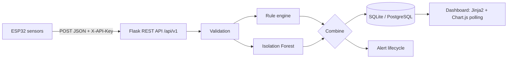

# ⚡ Smart Transformer Monitor (v2)

IoT fault-monitoring system: an **ESP32** streams temperature, voltage, current and oil level to a **Flask** REST API.
Every reading is scored by a **hybrid detector** (explainable rules + **Isolation Forest** anomaly model), stored in a
database, and shown on a live **Jinja2 + Chart.js** dashboard with alert history.

## Architecture



## What changed from v1

| v1 problem | v2 fix |
|---|---|
| `main.py` had a stray `-` (SyntaxError) | Rewritten as modular app (factory, blueprints, services) |
| Model trained on `Power`, served `Oil_Percentage` → every prediction crashed | One shared `features.py` for train + serve, plus tests |
| Model output `-1/1` never matched `"FAULT"` in dashboard | Clear statuses: `NORMAL / WARNING / FAULT / OFF` with human-readable reasons |
| CSV file as database (race conditions, schema drift) | SQLAlchemy models + indexes; `scripts/import_csv.py` keeps old history |
| No validation, no auth, `debug=True` on `0.0.0.0` | Range validation, `X-API-Key` auth, fail-closed config, JSON error handlers |
| Hard-coded `C:\Users\...` paths, 3 duplicate scripts | Config via env vars; one codebase |
| Full-page `sleep + rerun` refresh | Dashboard polls JSON API, pauses when tab hidden, detects offline device |
| No tests / CI / docs | 21 pytest tests, GitHub Actions, Docker, this README |

## Quick start

```bash
python -m venv .venv && source .venv/bin/activate      # Windows: .venv\Scripts\activate
pip install -r requirements-dev.txt
cp .env.example .env                                   # set API_KEY
python -m ml.train                                     # trains + prints cross-validated metrics
python run.py                                          # http://127.0.0.1:5000

# no hardware? fake an ESP32:
python scripts/simulate_device.py --api-key <your key> --scenario fault --count 40 --interval 0.5
```

Docker: `docker compose up --build` (reads `.env`; set a real `API_KEY` and remove `FLASK_DEBUG`).
Keep v1 history: `python scripts/import_csv.py ml/data/sample_readings.csv`.

## API (`/api/v1`)

| Method | Path | Notes |
|---|---|---|
| POST | `/transformers/<id>/readings` | 🔒 `X-API-Key`. Body: `temperature`, `voltage`, `current`, `oil` (cm to oil surface) |
| GET | `/transformers/<id>/readings?limit=&since=` | latest N (≤500), oldest first |
| GET | `/transformers/<id>/latest` | newest reading |
| GET | `/transformers/<id>/stats?hours=24` | min/avg/max + counts per status |
| GET | `/alerts?transformer_id=&active=true` | alert history |
| GET | `/health` | DB + model status |

```bash
curl -X POST http://localhost:5000/api/v1/transformers/1/readings \
  -H "Content-Type: application/json" -H "X-API-Key: $API_KEY" \
  -d '{"temperature": 65, "voltage": 10.5, "current": 2.0, "oil": 15}'
```

The old `/api/transformers/<id>/readings` route still works, so existing firmware only needs the new header.

## Detection logic

1. **Rules** (`services/rules.py`): config thresholds → `WARNING` / `FAULT` with a reason per violated limit. `OFF` when voltage and current are both 0.
2. **Isolation Forest** (`ml/train.py`): trained on healthy rows only (novelty detection); features Temperature, Voltage, Current, Oil %, Power (=V×I). Rules say `NORMAL` but pattern unusual → `WARNING`.
3. **Alerts** open only when severity *increases* (no spam) and auto-resolve when the unit returns to `NORMAL`.

**Model quality (honest numbers):** 5-fold cross-validation on 31 labelled rows → FAULT precision 0.92, recall 0.85.
Tiny dataset = proof of concept; the rule engine is the safety net. Next: log real sensor data and retrain.

## Layout

```
app/       config, models, schemas, auth, routes/, services/ (rules, ml, readings), templates/, static/
ml/        train.py + sample data        scripts/   simulate_device.py, import_csv.py
firmware/  ESP32 sketch                  tests/     pytest suite
```

## Roadmap
Alembic migrations · PostgreSQL in compose · Telegram/email on new FAULT · per-device keys · rate limiting · MQTT option
